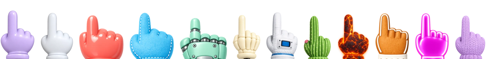

<p align="center"></p>

<h1 align="center">TinyHand for Linux</h1>

<p align="center"><strong>A tiny hand on a stick that points at things on your screen.</strong></p>

<p align="center">
  <a href="https://github.com/marsian83/tinyhand-linux/actions/workflows/ci.yml"></a>
  <a href="LICENSE"></a>
  
  
  <a href="https://tinyhand.app"></a>
</p>

<p align="center">
  <a href="#install"><strong>Install</strong></a>
  &nbsp;·&nbsp;
  <a href="#set-up-the-shortcut">Shortcut</a>
  &nbsp;·&nbsp;
  <a href="#use">How to use it</a>
  &nbsp;·&nbsp;
  <a href="#make-your-own-hand">Make your own hand</a>
  &nbsp;·&nbsp;
  <a href="docs/reference.md">Reference</a>
  &nbsp;·&nbsp;
  <a href="#differences-from-the-macos-app">Differences from macOS</a>
</p>

When you share your screen, a mouse cursor is a tiny arrow nobody follows. TinyHand turns
it into a hand on a stick: click to tap (with a little sound), drag to draw on the
screen, and hold <kbd>Alt</kbd> when you need to click something for real.

<p align="center">
  
</p>

This is a Linux port of [TinyHand](https://tinyhand.app) by
[Kamran Ahmed](https://github.com/kamranahmedse) ([nilbuild/tinyhand](https://github.com/nilbuild/tinyhand)).
The hands, the icon, the tap sounds and the way the arm moves all come from the
original macOS app. The port rewrites it in Rust for Wayland and X11, and its toolbar
follows your desktop's light or dark style and accent colour.

> [!NOTE]
> **Unofficial port.** It is not affiliated with or endorsed by the original author.
> Please report Linux problems [here](https://github.com/marsian83/tinyhand-linux/issues),
> not on the original project.

<p align="center">
  
</p>

<p align="center">36 hands and a laser dot. Pick one from the toolbar, or <a href="#make-your-own-hand">make your own</a>.</p>

## Install

You build it from source, which takes a few minutes. You need `git` and a stable
Rust toolchain (`cargo`).

```sh
git clone --depth 1 https://github.com/marsian83/tinyhand-linux.git
cd tinyhand-linux
cargo build --release
packaging/install.sh        # into ~/.local, no root needed
```

`~/.local/bin` has to be on your `PATH`. Then [bind `tinyhand toggle` to a key](#set-up-the-shortcut).

<details>
<summary><strong>Also build the settings window</strong></summary>

The settings window is a second program in the same workspace. It needs the GTK 4 and
libadwaita development packages (`gtk4` and `libadwaita` on Arch, `libgtk-4-dev` and
`libadwaita-1-dev` on Debian and Ubuntu, `gtk4-devel` and `libadwaita-devel` on Fedora).
Build everything before you run `install.sh` and it gets installed too:

```sh
cargo build --release --workspace
packaging/install.sh
```

</details>

<details>
<summary><strong>Install system-wide, or remove it again</strong></summary>

```sh
sudo packaging/install.sh --system   # into /usr/local
packaging/install.sh --uninstall     # remove it (add --system if you installed it there)
```

</details>

<details>
<summary><strong>Arch Linux package</strong></summary>

It isn't on the AUR yet. Build the package from the checkout:

```sh
cd packaging/arch
makepkg -si
```

</details>

<details>
<summary><strong>Debian / Ubuntu (.deb)</strong></summary>

```sh
cargo install cargo-deb
cargo build --release --workspace  # needs libgtk-4-dev and libadwaita-1-dev (settings window)
cargo deb --no-build
sudo apt install ./target/debian/tinyhand_*.deb
```

</details>

<details>
<summary><strong>Fedora / openSUSE (.rpm)</strong></summary>

```sh
cargo install cargo-generate-rpm
cargo build --release --workspace  # needs gtk4-devel and libadwaita-devel (settings window)
cargo generate-rpm
sudo dnf install ./target/generate-rpm/tinyhand-*.rpm
```

</details>

## Set up the shortcut

There is no menu bar icon and nothing runs in the background. `tinyhand toggle` starts
the pointer, and running it again ends the process. Wayland doesn't let apps grab global
keys, so bind the commands in your desktop's settings. The suggested keys match the
macOS app:

| Key | Command |
|---|---|
| **Ctrl+Alt+H** | `tinyhand toggle` |
| **Ctrl+Alt+X** | `tinyhand clear` |

**`tinyhand setup` prints the exact lines for the desktop you're on.** They are also here:

<details>
<summary><strong>Hyprland</strong></summary>

`~/.config/hypr/hyprland.conf`:

```ini
bind = CTRL ALT, H, exec, tinyhand toggle
bind = CTRL ALT, X, exec, tinyhand clear
layerrule = noanim, tinyhand
```

Newer Hyprland with a Lua config (`~/.config/hypr/hyprland.lua`):

```lua
hl.bind("CTRL + ALT + H", hl.dsp.exec_cmd("tinyhand toggle"), { description = "TinyHand pointer" })
hl.bind("CTRL + ALT + X", hl.dsp.exec_cmd("tinyhand clear"), { description = "TinyHand: clear drawing" })
hl.layer_rule({ match = { namespace = "tinyhand" }, no_anim = true })
```

</details>

<details>
<summary><strong>Sway</strong></summary>

`~/.config/sway/config`:

```
bindsym Ctrl+Alt+h exec tinyhand toggle
bindsym Ctrl+Alt+x exec tinyhand clear
```

</details>

<details>
<summary><strong>niri</strong></summary>

`~/.config/niri/config.kdl`:

```kdl
binds {
    Ctrl+Alt+H { spawn "tinyhand" "toggle"; }
    Ctrl+Alt+X { spawn "tinyhand" "clear"; }
}
```

</details>

<details>
<summary><strong>river</strong></summary>

`~/.config/river/init`:

```sh
riverctl map normal Control+Alt H spawn 'tinyhand toggle'
riverctl map normal Control+Alt X spawn 'tinyhand clear'
```

</details>

<details>
<summary><strong>KDE Plasma</strong></summary>

1. Open **System Settings > Keyboard > Shortcuts**.
2. Click **Add New > Command or Script...**, enter `tinyhand toggle` and press **Add**.
3. Select the new entry, click **Add custom shortcut** and press **Ctrl+Alt+H**.
4. Do the same for `tinyhand clear` with **Ctrl+Alt+X**.

If you installed a package, you can also use **Add New > Application...** and pick
TinyHand, which runs `tinyhand toggle`.

</details>

<details>
<summary><strong>GNOME</strong></summary>

GNOME has no layer-shell, so TinyHand uses its X11 backend through XWayland there.
Add the shortcuts in **Settings > Keyboard > Keyboard Shortcuts > Custom Shortcuts**,
or from a terminal:

```sh
KEY=/org/gnome/settings-daemon/plugins/media-keys/custom-keybindings
SCHEMA=org.gnome.settings-daemon.plugins.media-keys.custom-keybinding

gsettings set $SCHEMA:$KEY/tinyhand-toggle/ name 'TinyHand'
gsettings set $SCHEMA:$KEY/tinyhand-toggle/ command 'tinyhand toggle'
gsettings set $SCHEMA:$KEY/tinyhand-toggle/ binding '<Control><Alt>h'
gsettings set $SCHEMA:$KEY/tinyhand-clear/ name 'TinyHand: clear drawing'
gsettings set $SCHEMA:$KEY/tinyhand-clear/ command 'tinyhand clear'
gsettings set $SCHEMA:$KEY/tinyhand-clear/ binding '<Control><Alt>x'

# This replaces your list of custom shortcuts. If you already have some, run
# `gsettings get org.gnome.settings-daemon.plugins.media-keys custom-keybindings`
# and add the two paths below to what it prints instead.
gsettings set org.gnome.settings-daemon.plugins.media-keys custom-keybindings \
  "['$KEY/tinyhand-toggle/', '$KEY/tinyhand-clear/']"
```

</details>

## Use

| | |
|---|---|
| **Ctrl+Alt+H** (`tinyhand toggle`) | Turn the pointer on or off |
| Click | Tap (nothing underneath gets clicked) |
| Hold and drag | Draw on the screen (fades after 3 s by default) |
| Hold **Alt** and click | Click the thing underneath for real (needs [one more binding](docs/reference.md#click-for-real-hold-a-key)) |
| Scroll | Scrolls the window underneath |
| **Ctrl+Alt+X** (`tinyhand clear`) | Clear the drawing |
| Toolbar at the bottom | Pick a pinned hand or the laser dot, mute the tap, or exit |

`tinyhand settings` opens a window for the hand, its size, the ink colour, the tap sound
and the toolbar. The [reference](docs/reference.md) covers every command, the settings
window and the config file.

## Make your own hand

Run `tinyhand prompt knitted wool in mustard yellow` (any style you like), paste the
prompt into ChatGPT or another image tool, save the PNG it draws and run
`tinyhand make-hand that.png "Wool"`. TinyHand checks the image, puts it on a stick,
picks an ink colour and adds it to your hands. The settings window does the same with
drag and drop.

## Supported desktops

| Desktop | Session | How it draws | Status |
|---|---|---|---|
| Hyprland | Wayland | wlr-layer-shell | Tested |
| KDE Plasma, Sway, niri, river, COSMIC, Wayfire, labwc | Wayland | wlr-layer-shell | Should work (same protocols; not yet tested) |
| Xfce, Cinnamon, MATE, i3, KDE on X11, … | X11 | override-redirect windows | Tested on a headless Xorg; not yet on real desktops |
| GNOME | Wayland | X11 backend through XWayland (GNOME has no layer-shell) | Untested; "hold Alt" only works over X11 apps, use `tinyhand real` |

TinyHand picks Wayland when the compositor offers wlr-layer-shell and falls back to X11
otherwise. `TINYHAND_BACKEND=x11` or `=wayland` forces one.

## Resource use

Measured on a 2880×1800 laptop screen at 1.6× scaling, 120 Hz (Intel Core Ultra 200V,
Hyprland):

| | |
|---|---|
| While off | Nothing: no process, 0 bytes, 0 CPU |
| Memory while on | about 6 MB resident (2.7 MB proportional); about 11 MB (4.8 MB proportional) once the first tap sound has loaded the audio libraries |
| CPU while on and the mouse is still | 0 (no timers, no wakeups) |
| CPU while moving the mouse at 120 Hz | about 9 % of one core; ~0.5 ms to draw a frame |
| Start-up to first frame | about 13 ms with the prepared hands |
| Binary size | about 1.1 MB |

How it stays this small: the full-screen overlay is a single transparent pixel stretched
by the compositor; the hand, stick and ink are drawn on the CPU into small tiles that
only cover what's drawn; the shadow is drawn at quarter resolution and scaled up by the
compositor; and nothing runs between mouse events.

## Differences from the macOS app

- The port follows TinyHand 1.0.2. What 1.1.0 added isn't here yet: drawing arrows,
  double-tap Shift to click through, and the nine extra tap sounds.
- No menu bar icon or self-update: bind the commands to keys, change settings in
  `tinyhand settings` (or the config file), and update by pulling and building again.
  The settings window can't record shortcuts; it shows the lines to add to your desktop's
  key bindings instead. The toolbar has the pinned hands,
  the laser, sound and exit, but not the ink-colour tray or hint text (set `ink =` instead).
- **Esc doesn't turn the pointer off.** The overlay never takes the keyboard (so typing
  still reaches your app); use the toggle key.
- **Scrolling** reaches the window underneath, but the first notch of each scroll is
  used to let the rest through, and the hand hides for a moment while you scroll.
- **Hover effects** under the pointer (tooltips, highlighted links) don't show while the
  pointer is on, because the overlay receives the mouse.
- **Menus:** macOS lets clicks through to open menus automatically. On Linux, hold the
  click-for-real key to use menus.

## License

MIT, same as the original. See [LICENSE](LICENSE).

Copyright (c) 2026 Kamran Ahmed (TinyHand, artwork and sounds).
Copyright (c) 2026 Spandan Barve (Linux port).

"TinyHand" is the name of Kamran Ahmed's app. It is used here only to say what this
port is a port of.
